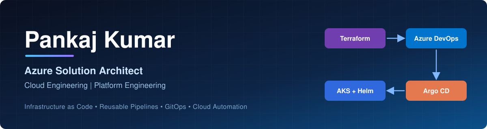
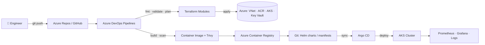

<div align="center">



# Pankaj Kumar Tiwari

### DevSecOps Architect &nbsp;|&nbsp; Azure Platform Engineering &nbsp;|&nbsp; Infrastructure Automation

*Build · Automate · Deploy*

[](https://github.com/pankajdsgithub)
[](https://www.linkedin.com/in/YOUR-LINKEDIN-ID)
[](#)

</div>

---

## 👨‍💻 About Me

I build and standardize cloud infrastructure, platform engineering capabilities and application delivery workflows using **Microsoft Azure, Terraform, Azure DevOps, Kubernetes and GitOps**.

- 🔐 **Secure by default** – least privilege, managed identities, policy and scan gates
- ♻️ **Reusable by design** – modular Terraform, shared pipeline templates
- 🚀 **Automated delivery** – repeatable infra provisioning and app deployment
- 📊 **Operationally ready** – metrics, logs, alerting and documented runbooks

---

## 🧰 Skills & Tools


---

## 📌 Featured Repositories

| Repository | What it does | Status |
|---|---|---|
| [**terraform-azure-platform**](https://github.com/pankajdsgithub/terraform-azure-platform) | Modular Azure IaC, reusable Terraform patterns, per-environment tfvars |  |
| [**azure-devops-infra-pipelines**](https://github.com/pankajdsgithub/azure-devops-infra-pipelines) | Reusable infra CI/CD templates + thin consumer pipelines |  |
| **azure-devops-app-pipelines** | Reusable application CI/CD framework |  |
| **kubernetes-helm-platform** | Helm charts for Kubernetes apps, env-specific values |  |
| **argocd-gitops-platform** | GitOps delivery with Argo CD |  |
| **aks-observability-platform** | Monitoring, logging and alerting for AKS |  |

> Links will be added as each repository goes live.

---

## 🏗️ Architecture



### Delivery workflow

`Source → Build → Secure → Package → Deploy → Operate`

---

## ✅ Build, Validation & Security

Every project follows the same quality gates:

| Gate | Tool | Purpose |
|---|---|---|
| Format | `terraform fmt -check` | Consistent code style |
| Validate | `terraform validate` | Config is syntactically valid |
| Plan | `terraform plan` | Review changes before apply |
| Image scan | `trivy image` | Fail on HIGH / CRITICAL vulnerabilities |
| Pipeline | Azure DevOps | Build, test, publish, deploy |

<details>
<summary><b>Sample output (illustrative, will be replaced with real run logs)</b></summary>

```text
$ terraform fmt -check
(no output = all files properly formatted)

$ terraform validate
Success! The configuration is valid.

$ trivy image --severity HIGH,CRITICAL <image>:<tag>
Total: 0 (HIGH: 0, CRITICAL: 0)
```

</details>

---

## 🗺️ Roadmap

- [x] Terraform Azure platform (modular structure)
- [ ] Reusable Azure DevOps infra pipeline templates
- [ ] Reusable app CI/CD templates
- [ ] Helm charts + Argo CD GitOps
- [ ] AKS observability stack (Prometheus + Grafana)
- [ ] Istio + Flagger progressive delivery

---

## 📚 Earlier Work

- [Machine Learning](https://github.com/pankajdsgithub/Machine-Learning)
- [Data Mining](https://github.com/pankajdsgithub/datamining)

---

<div align="center">

**Your GitHub profile is your digital portfolio – make it count.**

</div>
