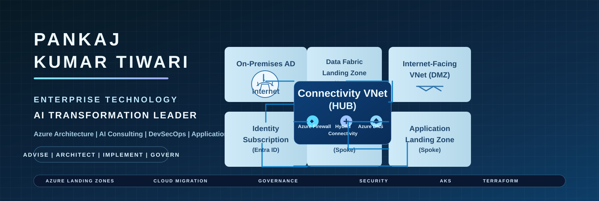

# Pankaj Kumar Tiwari

### Enterprise Technology &amp; AI Transformation Leader

**Azure Solution Architecture | DevOps &amp; Platform Engineering | Enterprise AI Consulting | Cloud Transformation | Application Delivery**

## Professional value proposition

I help enterprise organizations modernize their technology landscape through secure Azure architecture, intelligent automation, enterprise AI adoption, DevOps transformation and end-to-end application delivery.

I bridge business strategy, enterprise architecture, AI innovation and engineering execution. My work focuses on translating complex requirements into governed, scalable and measurable solutions.

## Leadership capabilities

- Enterprise Azure solution architecture and target-state design
- Azure Landing Zones, governance, identity and platform foundations
- DevSecOps, Azure DevOps and GitHub Actions delivery engineering
- Terraform, GitOps and reusable infrastructure automation
- Enterprise AI readiness, strategy and use-case prioritization
- Generative AI, RAG and agentic AI reference architectures
- AI governance, responsible AI, security and human-in-the-loop controls
- Cloud transformation, application modernization and project delivery

## Core technology portfolio

## Enterprise AI Solutions &amp; Transformation

My AI portfolio is organized around practical, reference and demonstration solutions rather than unverified production claims:

- **Enterprise AI Knowledge Assistant** — RAG architecture for organizational documents, grounded responses and source citations
- **Enterprise AI Agent Platform** — Tool-governed agent workflows with approval boundaries and auditability
- **AI-Powered IT Operations Assistant** — Alert correlation and incident analysis using Azure Monitor and Log Analytics
- **AI-Enabled DevOps Engineering Assistant** — Terraform, Kubernetes, pipelines, security findings and release analysis
- **Enterprise Document Intelligence** — Extraction, classification, validation and workflow automation for business documents

The portfolio emphasizes responsible AI, identity and access controls, prompt-injection defenses, output validation, human approval, cost monitoring and operational governance.

## Enterprise cloud engineering

```mermaid
flowchart LR
    A[Business Strategy] --> B[AI &amp; Cloud Readiness]
    B --> C[Architecture &amp; Use-Case Prioritization]
    C --> D[Reference Architecture / Proof of Concept]
    D --> E[Security, Governance &amp; Model Evaluation]
    E --> F[Infrastructure as Code &amp; CI/CD]
    F --> G[Azure Landing Zone &amp; AI Workload]
    G --> H[Monitoring, FinOps &amp; Continuous Improvement]
```

## Featured portfolio repositories

| Repository | Focus | Status |
|---|---|---|
| [enterprise-azure-landing-zone](https://github.com/pankajdsgithub/enterprise-azure-landing-zone) | Enterprise Azure platform, governance, connectivity and reusable Terraform patterns | Public reference |
| [azure-landing-zone-greenfield](https://github.com/pankajdsgithub/azure-landing-zone-greenfield) | Greenfield landing zone architecture and implementation guidance | Public reference |
| [terraform-azure-platform](https://github.com/pankajdsgithub/terraform-azure-platform) | Terraform-based Azure infrastructure foundation | Public reference |
| [secure-azure-genai](https://github.com/pankajdsgithub/secure-azure-genai) | Secure Azure generative AI architecture and delivery patterns | Reference / working area |

Repository status and deployment maturity are documented in each project. Reference architectures and demonstrations are not represented as production implementations without evidence.

## Professional positioning

Target roles include:

- Enterprise AI Consultant
- AI Solution Architect
- Azure AI Architect
- Enterprise AI Transformation Consultant
- Generative AI Consultant
- AI Platform Architect
- AI and Cloud Transformation Lead
- Enterprise Automation Architect
- AI-enabled DevOps Transformation Lead

## Engineering principles

- Business outcomes before technology choices
- Secure-by-default and policy-led governance
- Infrastructure and application delivery as code
- Least privilege and human approval for sensitive actions
- Model, prompt, retrieval and configuration versioning
- Evaluation gates before production deployment
- Observable, cost-aware and reversible operations
- Clear separation of reference, prototype, lab and production states

---

**Advising what to build. Designing how to build it. Leading secure implementation and delivery.**

