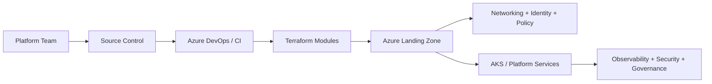

# Pankaj Kumar Tiwari

### Azure Solution Architect | Cloud Transformation | Platform Engineering | Azure Landing Zones

---

## About

Azure Solution Architect and Platform Engineer helping organizations accelerate cloud transformation through secure, scalable, and governable Azure platforms. I design landing zone foundations, automate platform delivery with Terraform, and enable migration and modernization programs that align technology, security, and operations with business outcomes.

- Azure solution architecture and target-state design
- Cloud transformation and enterprise modernization programs
- Azure landing zones, governance, and platform baselines
- Terraform-based infrastructure automation and reusable IaC patterns
- Azure DevOps pipelines and secure-by-default delivery workflows
- AKS and Kubernetes enablement for modern application platforms
- Migration readiness, modernization strategy, and resilient cloud operations

---

## Core competencies

---

## Featured portfolio projects

| Repository | Focus | Status |
|---|---|---|
| [terraform-azure-platform](https://github.com/pankajdsgithub/terraform-azure-platform) | Secure Azure infrastructure foundation with reusable Terraform patterns and environment-aware configuration | Active |
| [azure-landing-zone-greenfield](https://github.com/pankajdsgithub/azure-landing-zone-greenfield) | Greenfield landing zone concepts covering governance, connectivity, identity, and platform baselines | Public reference |
| Migration & Modernization | Azure transformation strategy, landing zone readiness, governance uplift, and secure platform modernization for legacy estates | Focus area |

> The portfolio emphasizes real Azure platform engineering work, governance-driven automation, and enterprise cloud transformation patterns.

---

## Cloud transformation and migration focus

I support Azure transformation initiatives spanning landing zone readiness, modernization planning, and secure platform enablement for enterprise workloads.

- Azure migration strategy and target-state architecture
- Hybrid connectivity, Azure Arc, and workload transition planning
- Landing zone design for greenfield and brownfield estates
- Platform governance uplift for legacy environments
- Secure-by-default modernization patterns for enterprise workloads
- Operating model alignment across security, governance, and platform teams

---

## What I design

- Secure Azure landing zones and enterprise platform foundations
- Terraform-driven infrastructure with environment-aware configuration
- CI/CD pipelines for standardized provisioning and release workflows
- AKS and Kubernetes platform enablement with governance guardrails
- DevSecOps controls that support secure-by-default delivery
- Scalable cloud operating models for transformation and modernization programs

---

## Architecture focus

This profile reflects the core Azure solution architecture pattern I work with:

- Source control and review-driven delivery
- CI checks for formatting, validation, and quality gates
- Terraform as the standard for infrastructure provisioning
- Azure landing zone baselines for security and governance
- AKS and platform services on top of a governed foundation

---

## Portfolio roadmap

- [x] Azure platform foundation repository
- [ ] Reusable Azure DevOps pipeline templates
- [ ] Governance and policy automation patterns
- [ ] AKS delivery and GitOps workflows
- [ ] Security scanning and platform hardening patterns
- [ ] Azure migration and modernization architecture patterns
- [ ] Hybrid connectivity and Azure Arc enablement patterns
- [ ] Cloud transformation playbooks for enterprise platform teams

---

## Repository standards

The portfolio follows a disciplined cloud engineering approach:

- secure-by-default design and policy-led governance
- infrastructure as code for repeatability and scalability
- clear separation between platform baseline and workload delivery
- environment-aware configuration with validation before change
- automation that supports governance, resilience, and operational consistency

---

## GitHub

[GitHub Profile](https://github.com/pankajdsgithub)

---

**Azure platform engineering with security, automation, and governance at the center.**

