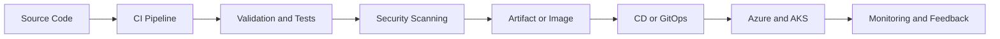

 

  

<h1 align="center">Pankaj Kumar Tiwari</h1>

<h3 align="center">DevSecOps Architect | Azure Platform Engineering | Infrastructure Automation</h3>

  
  
  
  

## Professional Profile

I build and standardize cloud infrastructure, platform engineering capabilities, and application delivery workflows using Microsoft Azure, Terraform, Azure DevOps, containers, Kubernetes, and GitOps.

My engineering focus is on reusable infrastructure modules, secure-by-default cloud platforms, standardized CI/CD templates, automated deployment workflows, and operational reliability.

I aim to bridge **cloud architecture, DevSecOps automation, platform engineering, and production operations** through maintainable code, repeatable deployments, and engineering standards.

## Engineering Focus

| Domain | Engineering Capabilities |
|---|---|
| **Azure Cloud Architecture** | Azure Landing Zones, governance, identity, networking, private connectivity |
| **Infrastructure as Code** | Terraform modules, `for_each`, environment-specific configuration, reusable patterns |
| **DevSecOps & CI/CD** | Pipeline templates, validation gates, security scanning integration, deployment automation |
| **Containers & Kubernetes** | Docker, AKS, Kubernetes workloads, Helm charts, deployment reliability |
| **GitOps & Platform Engineering** | Argo CD, declarative delivery, environment consistency, configuration management |
| **Observability & SRE** | Metrics, logs, traces, dashboards, alerting, service reliability |

## Core Technology Stack

  
  
  
  
  
  
  
  
  
  
  
  
  

## Architecture Principles

- **Security by default:** least privilege, managed identities, secure connectivity, and controlled access.
- **Reusable by design:** modular Terraform, shared pipeline templates, and standardized configuration.
- **Automated delivery:** repeatable infrastructure provisioning and application deployment.
- **Policy and quality gates:** infrastructure validation and security checks integrated into delivery workflows.
- **Operational readiness:** health checks, metrics, logs, alerting, and documented troubleshooting.
- **Environment consistency:** version-controlled configuration and explicit environment-specific values.

## Featured Engineering Projects

| Project | Engineering Focus | Status |
|---|---|---|
| [terraform-azure-platform](https://github.com/pankajdsgithub/terraform-azure-platform) | Modular Azure infrastructure, reusable Terraform patterns, environment-specific tfvars | In progress |
| [azure-devops-infra-pipelines](https://github.com/pankajdsgithub/azure-devops-infra-pipelines) | Reusable infrastructure pipeline templates and thin consumer pipelines | In progress |
| `azure-devops-app-pipelines` | Reusable application CI/CD templates | Planned |
| `kubernetes-helm-platform` | Helm charts and environment-specific deployment configuration | Planned |
| `argocd-gitops-platform` | Declarative application delivery and GitOps synchronization | Planned |
| `aks-observability-platform` | Kubernetes monitoring, dashboards, logs, and alerting | In progress |

*Project statuses reflect current development plans and should be updated as implementation and validation progress.*

## Engineering Workflow

## Earlier Work

My GitHub also contains earlier learning projects:

- [Machine-Learning](https://github.com/pankajdsgithub/Machine-Learning)
- [datamining](https://github.com/pankajdsgithub/datamining)

## Connect

- **GitHub:** [github.com/pankajdsgithub](https://github.com/pankajdsgithub)
- **LinkedIn:** Add your verified LinkedIn profile URL here.

---

  <i>Building secure, reusable, automated, and observable cloud platforms.</i>

