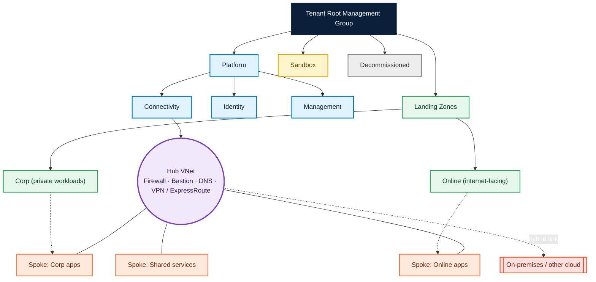

<div align="center">


# Pankaj Kumar Tiwari

### DevSecOps Architect &nbsp;|&nbsp; Azure Platform Engineering &nbsp;|&nbsp; Infrastructure Automation

*Build · Automate · Deploy*

[](https://github.com/pankajdsgithub)
[](https://www.linkedin.com/in/YOUR-LINKEDIN-ID)
[](#)

</div>

---

## 👨‍💻 About Me

I build and standardize cloud infrastructure, platform engineering capabilities and application delivery workflows using **Microsoft Azure, Terraform, Azure DevOps, Kubernetes and GitOps**.

- 🔐 **Secure by default**: least privilege, managed identities, policy and scan gates
- ♻️ **Reusable by design**: modular Terraform, shared pipeline templates
- 🚀 **Automated delivery**: repeatable infrastructure provisioning and app deployment
- 📊 **Operationally ready**: metrics, logs, alerting and documented runbooks

---

## 🧰 Skills & Tools


---

## 📌 Featured Repositories

### 🏛️ Cloud Architecture & Azure Landing Zones

**Greenfield (new Azure environments)**

| Repository | What it does | Tech | Status |
|---|---|---|---|
| **azure-landing-zone-greenfield** | Enterprise-scale landing zone: management groups, policy, identity, connectivity, management | `Terraform` `Azure Policy` |  |
| **azure-hub-spoke-network** | Hub-and-spoke network with Azure Firewall, Bastion, private DNS and private endpoints | `Terraform` `Azure Networking` |  |
| **azure-subscription-vending** | Automated subscription vending with baseline policy, RBAC and networking | `Terraform` `Azure DevOps` |  |

**Migration (from on-premises or other clouds)**

| Repository | What it does | Tech | Status |
|---|---|---|---|
| **onprem-to-azure-migration-landing-zone** | Landing zone and wave plan for datacenter migration: Azure Migrate, ExpressRoute / VPN, hybrid identity | `Azure Migrate` `Terraform` |  |
| **aws-gcp-to-azure-migration** | Multi-cloud to Azure migration: assessment, 6R strategy, target design, cutover runbooks | `Architecture` `Azure` |  |
| **hybrid-connectivity-and-arc** | Hybrid connectivity patterns and Azure Arc for servers and Kubernetes during transition | `Azure Arc` `ExpressRoute` |  |

### Infrastructure as Code

| Repository | What it does | Tech | Status |
|---|---|---|---|
| [**terraform-azure-platform**](https://github.com/pankajdsgithub/terraform-azure-platform) | Modular Azure IaC, reusable patterns, per-environment tfvars | `Terraform` `Azure` |  |
| **terraform-aks-cluster** | Production-style AKS cluster with node pools, networking and managed identity | `Terraform` `AKS` |  |
| **azure-policy-governance** | Azure Policy and RBAC as code: tagging, allowed regions, security baselines | `Terraform` `Azure Policy` |  |

### CI/CD & DevSecOps

| Repository | What it does | Tech | Status |
|---|---|---|---|
| [**azure-devops-infra-pipelines**](https://github.com/pankajdsgithub/azure-devops-infra-pipelines) | Reusable infra pipeline templates and thin consumer pipelines | `YAML` `Azure DevOps` |  |
| **azure-devops-app-pipelines** | Reusable application CI/CD framework (build, test, scan, publish) | `YAML` `Docker` |  |
| **devsecops-security-scanning** | Trivy image scan, secret scan and IaC scan gates for pipelines | `Trivy` `Bash` |  |
| **github-actions-reusable-workflows** | Shared GitHub Actions workflows for lint, validate and release | `GitHub Actions` |  |

### Kubernetes, GitOps & Observability

| Repository | What it does | Tech | Status |
|---|---|---|---|
| **kubernetes-helm-platform** | Helm charts and environment-specific deployment values | `Helm` `Kubernetes` |  |
| **argocd-gitops-platform** | Declarative delivery and GitOps sync with Argo CD | `Argo CD` `Shell` |  |
| **aks-observability-platform** | Monitoring, dashboards, logs and alerting for AKS | `Prometheus` `Grafana` |  |
| **istio-flagger-progressive-delivery** | Canary releases with Istio traffic shifting and Flagger | `Istio` `Flagger` |  |

> Repository links are added as each project goes live.

---

## 🏗️ Architecture

### Platform delivery (CI/CD → GitOps → AKS)

```mermaid
flowchart LR
    subgraph SRC["1. Source"]
        U(["👤 Engineer"]) -->|git push| R["Git Repository"]
    end

    subgraph CI["2. CI/CD and Security Gates"]
        P["Azure DevOps Pipelines"]
        Q{{"fmt · validate · plan"}}
        S{{"Trivy image scan"}}
        P --> Q
        P --> S
    end

    subgraph IAC["3. Infrastructure as Code"]
        T["Terraform Modules"]
        A[("Azure: VNet · ACR · AKS · Key Vault")]
        T -->|apply| A
    end

    subgraph GITOPS["4. GitOps Delivery"]
        ACR["Azure Container Registry"]
        H["Helm charts in Git"]
        AC["Argo CD"]
        ACR --> H -->|sync| AC
    end

    subgraph RUN["5. Run and Observe"]
        K["AKS Cluster"]
        O["Prometheus · Grafana · Logs"]
        K --> O
    end

    R --> P
    Q --> T
    S --> ACR
    AC -->|deploy| K

    classDef src fill:#E8F1FF,stroke:#2F6FDB,color:#0B1F3A,stroke-width:2px
    classDef ci fill:#E0F4FF,stroke:#0078D4,color:#0B1F3A,stroke-width:2px
    classDef gate fill:#FFF4CC,stroke:#E0A800,color:#5C4400,stroke-width:2px
    classDef iac fill:#F1E8FB,stroke:#7B42BC,color:#2E1A4D,stroke-width:2px
    classDef azure fill:#D6ECFF,stroke:#0078D4,color:#0B1F3A,stroke-width:2px
    classDef gitops fill:#FFE9DC,stroke:#EF7B4D,color:#6B2A0B,stroke-width:2px
    classDef k8s fill:#DCE7FF,stroke:#326CE5,color:#0B1F3A,stroke-width:2px
    classDef obs fill:#FFE0DC,stroke:#E6522C,color:#6B1A0B,stroke-width:2px

    class U,R src
    class P ci
    class Q,S gate
    class T iac
    class A azure
    class ACR,H,AC gitops
    class K k8s
    class O obs

    style SRC fill:#F5F9FF,stroke:#9DB7D8,stroke-dasharray: 4 4
    style CI fill:#F0FAFF,stroke:#7CC4F0,stroke-dasharray: 4 4
    style IAC fill:#FAF6FE,stroke:#B99AE0,stroke-dasharray: 4 4
    style GITOPS fill:#FFF8F3,stroke:#F5B293,stroke-dasharray: 4 4
    style RUN fill:#F4F7FF,stroke:#9DB4EE,stroke-dasharray: 4 4
```



**Delivery workflow:** `Source → Build → Secure → Package → Deploy → Operate`

### Azure Landing Zone (hub-spoke)



---

## ✅ Build, Validation & Security

Every project follows the same quality gates:

| Gate | Tool | Purpose |
|---|---|---|
| Format | `terraform fmt -check` | Consistent code style |
| Validate | `terraform validate` | Configuration is valid |
| Plan | `terraform plan` | Review changes before apply |
| Image scan | `trivy image` | Fail on HIGH / CRITICAL vulnerabilities |
| Pipeline | Azure DevOps | Build, test, publish, deploy |

Sample output (illustrative; real run logs are added per project):

```text
$ terraform fmt -check
(no output: all files are properly formatted)

$ terraform validate
Success! The configuration is valid.

$ trivy image --severity HIGH,CRITICAL <image>:<tag>
Total: 0 (HIGH: 0, CRITICAL: 0)
```

---

## 🗺️ Roadmap

- [x] Terraform Azure platform (modular structure)
- [ ] Reusable Azure DevOps infra pipeline templates
- [ ] Reusable app CI/CD templates
- [ ] DevSecOps scanning gates (Trivy)
- [ ] Helm charts + Argo CD GitOps
- [ ] AKS observability stack (Prometheus + Grafana)
- [ ] Istio + Flagger progressive delivery
- [ ] Azure Policy governance as code
- [ ] Azure Landing Zone: greenfield design (management groups, hub-spoke, policy)
- [ ] Azure Landing Zone: migration design (on-premises and other clouds to Azure)

---

## 📚 Earlier Work

- [Machine Learning](https://github.com/pankajdsgithub/Machine-Learning)
- [Data Mining](https://github.com/pankajdsgithub/datamining)

---

<div align="center">

**Your GitHub profile is your digital portfolio. Make it count.**

</div>
