# Azure Cloud Transformation Blueprint

This document describes a portfolio reference architecture for Azure solution design, cloud migration, landing zone implementation, and platform engineering. It is intended to communicate a credible enterprise pattern rather than a live deployment claim.

## Architecture summary

```mermaid
flowchart LR
    A[Business Requirements] --> B[Discovery and Assessment]
    B --> C[Current-State Inventory]
    C --> D[Target Azure Landing Zone]
    D --> E[Identity, Networking, Policy]
    E --> F[Hybrid Connectivity and Azure Arc]
    F --> G[Migration Waves]
    G --> H[Application Modernization]
    H --> I[Secure Platform Operations]
    I --> J[Monitoring, Governance, Cost Control]
```

## Core transformation flow

### 1. Discover and assess
- Inventory applications, workloads, dependencies, and data flows.
- Evaluate business criticality, data sensitivity, and change complexity.
- Capture current-state networking, identity, and operational maturity.

### 2. Define the target platform
- Establish Azure landing zone baselines for governance and security.
- Define management group structure, subscriptions, RBAC, and policy boundaries.
- Align resource naming, tagging, and lifecycle ownership with enterprise standards.

### 3. Establish connectivity and governance
- Enable secure access patterns, hybrid connectivity, and private endpoint design.
- Implement policy enforcement for allowed regions, standardized services, and security controls.
- Use Azure Arc for hybrid resource visibility and governance consistency.

### 4. Plan migration waves
- Group workloads by complexity, dependency, and outage sensitivity.
- Separate pilot, wave-based migration, and rollback stages.
- Validate application readiness, network readiness, and operational ownership before cutover.

### 5. Modernize and optimize
- Replatform or refactor workloads where the cloud-native model provides clear value.
- Optimize for resiliency, automation, cost transparency, and service lifecycle management.
- Standardize application delivery through Terraform, CI/CD, and GitOps patterns.

### 6. Operate securely and efficiently
- Implement observability, alerting, and operations runbooks.
- Control cost through tagging, budgets, policy guardrails, and autoscaling decisions.
- Treat security, reliability, and governance as continuous platform responsibilities.

## Architecture principles

- Secure-by-default platform design
- Policy-driven governance and least privilege
- Reusable Infrastructure as Code patterns
- Standardized CI/CD and environment promotion
- Hybrid-first migration planning
- Operational clarity and measurable platform health

## Portfolio positioning

This blueprint supports the practice areas represented across the profile:

- Azure Solution Architecture
- Cloud Transformation and Migration
- Azure Landing Zones
- Platform Engineering
- DevSecOps and automation
- AKS, Helm, and GitOps enablement

## Scope and limitations

This document represents a reference architecture and design perspective for portfolio purposes. It does not imply that Azure resources were deployed or validated in a live production tenant as part of this repository.
