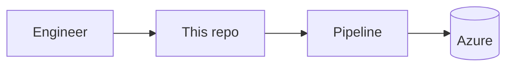

# <repo-name>

> One-line description of what this repository does.


## Overview
What problem it solves and who it is for (2-3 lines).

## Architecture



## Repository structure

```text
.
├── modules/          # reusable modules
├── environments/     # dev / test / stage / prod tfvars
├── pipelines/        # CI/CD definitions
└── docs/
```

## Prerequisites
- Azure subscription and a service principal / managed identity
- Terraform >= 1.5, Azure CLI

## Usage

```bash
terraform init
terraform fmt -check
terraform validate
terraform plan -var-file=environments/dev.tfvars
terraform apply -var-file=environments/dev.tfvars
```

## Validation & security
Paste your real command output here (fmt, validate, plan, Trivy).

## Roadmap
- [ ] Item 1
- [ ] Item 2

## Author
**Pankaj Kumar Tiwari**: [GitHub](https://github.com/pankajdsgithub)
